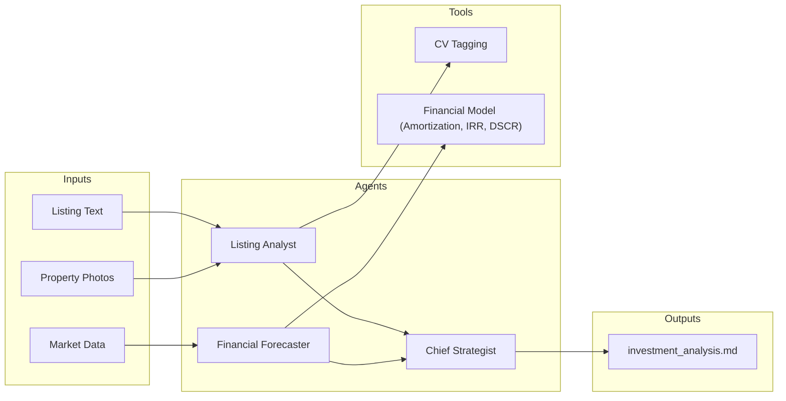
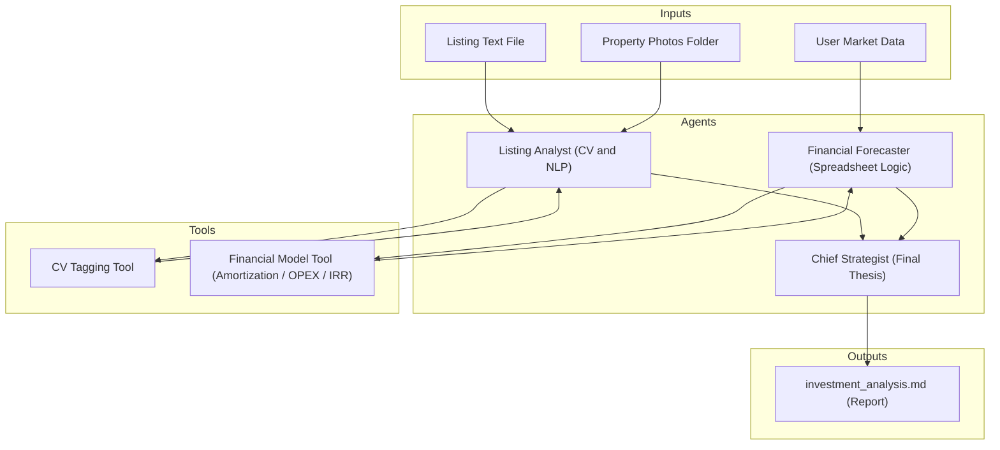
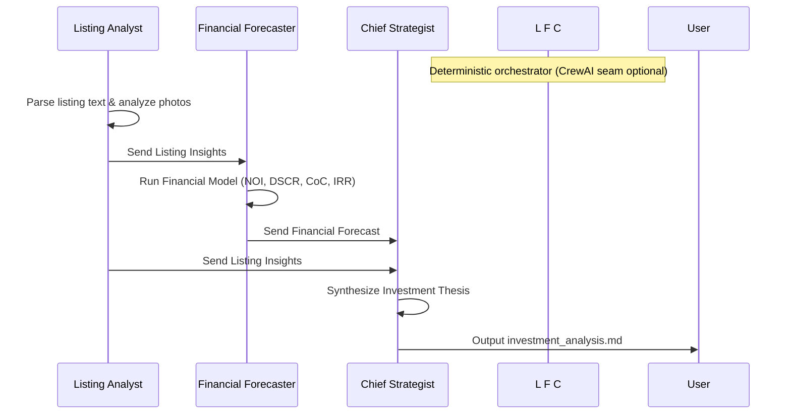
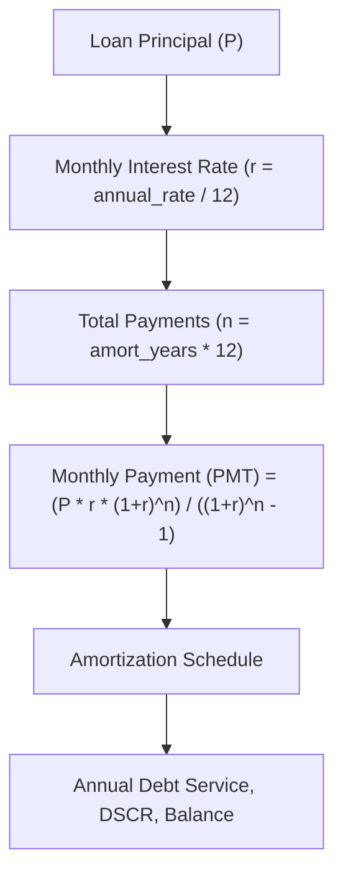

[](https://codecov.io/gh/rogerbooto/ai-real-estate-deal-analyzer)


[](https://github.com/rogerbooto/ai-real-estate-deal-analyzer/releases)

# The AI Real Estate Deal Analyzer

A deterministic-first investment co-pilot that ingests a real estate listing (text, HTML, and photos) and user-provided financial data to perform a rigorous, Grant Cardone–inspired investment analysis — producing a comprehensive financial breakdown, media insights, and a human-readable investment thesis.

This project is a portfolio piece designed to showcase a modern, agent-seamed architecture for complex decision-making and analysis. The core pipeline is **fully deterministic and reproducible**; AI layers (vision providers, CrewAI orchestration) are opt-in seams that default to deterministic stubs.

---

## Quick Start

Run the demo in **one line**:

```bash
git clone https://github.com/rogerbooto/ai-real-estate-deal-analyzer.git && cd ai-real-estate-deal-analyzer && python3 -m venv .venv && source .venv/bin/activate && pip install -r requirements.lock && python main.py
```

Expected output:

```text
Running AI Real Estate Deal Analyzer (V3)...
Report written to investment_analysis.md
Thesis verdict: DECLINE
```

> With no arguments, `main.py` underwrites the committed sample bundle at `data/sample_listings/36_kelly_moncton/` — a $399,900 legal up/down duplex in Moncton, NB. The bundle holds `listing.txt`, `photos/`, and `inputs.json` (financing, per-unit income, opex), so the listing, the photos, and the financials all describe the same deal. To analyse your own, pass `--config` — and pass it *with* `--listing`/`--photos`, never instead of them: an asset flag on its own would be underwritten against the demo deal's price and rent roll, so the run refuses with an error rather than reporting your address above someone else's numbers.

### Demo Artifacts

* Sample deal bundles under `data/sample_listings/`:
  * `36_kelly_moncton/` — **the default demo** (listing.txt, photos/, inputs.json); a $399,900 two-unit duplex, underwritable end-to-end
  * `47_perrot_shediac/` — advisor fixture (listing.txt, photos/, finance.json); a single-family leasehold mini-home with advisor-shaped scoring inputs, not a full `FinancialInputs` config
* Example JSON artifacts: `data/examples/` (forecast, insights, media, thesis)
* Example outputs: `artifacts/*.md` / `artifacts/*.pdf` (e.g., `36_kelly_analysis.md`, `20_gallagher_analysis.md`)

### Command-Line Interfaces

Beyond `main.py`, three CLIs cover ingestion, reporting, and multi-deal advising (run as modules; see note on packaging below):

```bash
# Ingest a listing (file or URL): prints synthesized listing insights + photo insights, and a
# media summary. Media discovery/download/intelligence flags (--download-media/--media-intel/
# --media-kinds) only take effect with --url (an HTML source to scan for media links); --file
# input alone still gets photo insights via --photos, and prints a note on stderr explaining why
# those media flags are ignored in that mode. See src/cli/README.md for the full flag reference.
python -m src.cli.ingest_cli --file listing.html --photos ./photos

# Render a Markdown investment report from JSON artifacts
python -m src.cli.report_cli --forecast forecast.json --insights insights.json --out report.md

# Rank multiple deals and summarize a portfolio (directory bundles or config JSONs)
python -m src.cli.advisor_cli --dir data/sample_listings/47_perrot_shediac --out out/advisor_output.json --markdown
```

> `pyproject.toml` declares `ingest-listing`, `deal-report`, and `deal-advisor` console scripts. After `pip install -e .` these resolve directly (`ingest-listing --help`, etc.); the `python -m src.cli.*` forms above remain valid if you prefer not to install the package.

---

## Documentation Index

This section links to in-depth READMEs for each `src/` subfolder.

| Folder             | Description                                                                                          | Link                                                   |
| ------------------ | ---------------------------------------------------------------------------------------------------- | ------------------------------------------------------ |
| **schemas/**       | Pydantic models defining all data contracts (inputs, forecasts, listings, media, market scenarios).  | [schemas/README.md](src/schemas/README.md)             |
| **core/**          | Deterministic finance engine, ingestion, normalization, CV, media, advisor, and intelligence logic.  | [core/README.md](src/core/README.md)                   |
| **cli/**           | Command-line entry points: listing ingest, report rendering, multi-deal advisor.                     | [cli/README.md](src/cli/README.md)                     |
| **orchestrators/** | End-to-end pipeline coordinators for deterministic and (seamed) CrewAI modes.                        | [orchestrators/README.md](src/orchestrators/README.md) |
| **agents/**        | High-level wrappers managing listing, finance, and strategy tasks.                                   | [agents/README.md](src/agents/README.md)               |
| **core/reports/**  | Markdown report generator for forecasts, media insights, and investment theses.                      | [core/reports/README.md](src/core/reports/README.md)   |
| **inputs/**        | Input loading, validation, and environment override logic.                                           | [inputs/README.md](src/inputs/README.md)               |
| **market/**        | Market snapshot, hypothesis grid, and rejector; wired into the pipeline as the opt-in `--scenarios` overlay. | [market/README.md](src/market/README.md)               |

> Relationships: `inputs → orchestrators → agents → core → core/reports`, with `market` optional and `cli` as user-facing entry points.

---

## The Problem: Analysis Paralysis in Real Estate Investing

For an aspiring real estate investor, evaluating a potential deal is a time-consuming, manual, and error-prone process. It involves:

* Manually parsing property photos and descriptions.
* Scouring multiple websites for comparable sales ("comps").
* Plugging dozens of numbers into a complex spreadsheet.
* Making a high-stakes financial decision based on incomplete data and gut feeling.

This "analysis paralysis" prevents many would-be investors from ever taking action.

---

## The Solution: An Autonomous AI Co-pilot

This project solves the problem by deploying a team of specialized AI agents that work together to perform a comprehensive deal analysis in seconds. It acts as an expert co-pilot, handling the heavy lifting of data analysis and financial modeling, allowing the human investor to focus on the final decision.

The system's unique value is its **opinionated financial model**, which implements the core principles of Grant Cardone's real estate investment methodology to calculate critical metrics like Net Operating Income (NOI), Cash-on-Cash Return, and Debt Service Coverage Ratio (DSCR).

---

## High-Level Architecture

At a glance, the system is a multi-agent pipeline with a **deterministic orchestrator by default** and a **CrewAI seam** for optional LLM-backed runs (`--engine crewai`). Choosing `--engine crewai` still fail-fast validates the environment (a provider key and an importable `crewai` package) before anything runs. With `AIREAL_LLM_MODE` unset (the default), that seam builds **no crewai `Agent` shell at all** — `FinancialForecasterAgent` and `ChiefStrategistAgent` never construct one, in any mode, and the Listing Analyst's shell is built lazily, only when the LLM path actually runs — and every step delegates to the same deterministic math. With `AIREAL_LLM_MODE` set **and** a provider key present, the Listing Analyst's `crew.kickoff()` does run — an LLM authors *observations* (condition tags, defects, amenities) that flow into the forecast through the deterministic insight modifiers. **The verdict never goes through a model, in any mode:** the Chief Strategist always synthesizes the final BUY/CONDITIONAL/DECLINE thesis from the same deterministic rule engine (`chief_strategist.synthesize_thesis`), so an AI-influenced deal still gets its judgment from the identical rules every other deal goes through.



---

## Technical Architecture

The system is built as a **multi-agent pipeline** with clear separation of concerns, where each agent is an expert in its domain. Orchestration is deterministic by default; a CrewAI-based engine is available as a seam for opt-in LLM-authored *observations* (`AIREAL_LLM_MODE`, Listing Analyst only) — the verdict stays rule-based in every mode.

The primary agents are:

* **Listing Analyst:** Analyzes property photos (deterministic CV tagging, with provider seams for AI vision) and listing text to extract key features and data points.
* **Financial Forecaster:** A financial modeling expert that implements the core investment spreadsheet logic, calculating NOI, cash flow, and return metrics.
* **Chief Strategist:** The final decision-maker that synthesizes all data into a clear, human-readable investment thesis (rule-based always — `ChiefStrategistAgent.run` never routes the verdict through an LLM, in any mode).

*(Note: live market research is out of scope; financial inputs are provided locally. Listing ingestion supports local files and — behind an explicit opt-in fetch policy with robots.txt respect — remote URLs.)*

---

## System Overview



---

## Agent Collaboration



---

## How We Model Debt Service

We use a standard **loan amortization model** to compute annual debt service:



This model feeds into our per-year pro forma:

* **Debt Service** = principal + interest for that year
* **DSCR** = NOI ÷ Debt Service
* **Balance After Year N** = outstanding loan principal

---

## Tech Stack

* **Language:** Python 3.10
* **Orchestration:** Deterministic pipeline (default) + CrewAI seam (optional engine)
* **Computer Vision:** Deterministic filename/heuristic tagging with closed-set ontology; provider seams for `vision`/`llm` stubs and user-registered ONNX models; perceptual-hash media intelligence (Pillow)
* **Ingestion:** BeautifulSoup HTML parsing, address parsing via `usaddress`, robots-respecting fetch policy
* **Data Modeling:** Pydantic v2
* **Testing:** Pytest (+ coverage via pytest-cov / Codecov)
* **Lint/Type:** Ruff, mypy (strict)
* **Deps:** `requirements.txt` (runtime) + `requirements-dev.txt` (dev) declare the *ranges*. Two hash-pinned `uv`-generated lockfiles hold the exact versions: **`requirements.lock`** (runtime only — what you need to run the tool) and **`requirements-dev.lock`** (runtime + test/lint/type tooling — what CI installs). See [Developer Setup](#developer-setup) to regenerate them.
* **Packaging:** `pyproject.toml` declares `[project]` metadata and the `ingest-listing` / `deal-report` / `deal-advisor` console scripts; `pip install -e .` installs them (see [Developer Setup](#developer-setup)). The `python -m src.cli.*` forms also work without installing the package.

---

## Project Goals

* Demonstrate mastery of **agentic design patterns**.
* Implement a **transparent and opinionated financial model**.
* Deliver professional-quality code, tests, and documentation in a public repo.

---

## Usage Example

The demo runs on the committed `36_kelly_moncton` bundle (see [Demo Artifacts](#demo-artifacts)); hardcoded inputs are only a last-resort fallback if that bundle is missing.
You can run the full pipeline (Listing Analyst → Financial Forecaster → Chief Strategist) directly:

```bash
# Run demo analysis
python main.py

# Or with explicit config/assets (--listing/--photos require --config for the same property)
python main.py --config data/sample_listings/36_kelly_moncton/inputs.json --out out.md --horizon 10 \
               --listing data/sample_listings/36_kelly_moncton/listing.txt --photos data/sample_listings/36_kelly_moncton/photos

# Opt-in Market Scenarios overlay (deterministic what-if scenarios)
python main.py --config data/sample_listings/36_kelly_moncton/inputs.json --scenarios
```

Expected console output:

```text
Running AI Real Estate Deal Analyzer (V3)...
Report written to investment_analysis.md
Thesis verdict: DECLINE
```

This generates a Markdown report in the project root:

* **`investment_analysis.md`** → Contains the financial forecast, year-by-year breakdown, and final investment thesis.

### Actionable Recourse — "What Would Have to Change?"

For deals that are genuinely close to the line — at least one and at most three of the seven live guardrails failing on the baseline forecast (`is_genuinely_close`'s fail-count gate, which never inspects the verdict itself) — the report appends a new "What would have to change?" section listing the single most impactful investor-movable change per failing guardrail. In practice a `BUY` (0 fails, by definition) never triggers this; every `CONDITIONAL` deal does (`CONDITIONAL` is defined as 1–2 fails); and a `DECLINE` deal can too, whenever it still lands in the 1–3 range. Each row expresses the answer in a currency the investor can move: rent per unit per month, purchase price, interest rate, or annual operating costs. Implausible levers (e.g. a $5M rent increase) are flagged with their reason but never removed — the system does not know what an investor can move.

**Every figure comes from re-running the engine** on a perturbed input, not from inverting a formula, because the levers are not independent (e.g. cutting price shrinks the loan, lifts the cap rate, and changes cash-in all at once). When multiple guardrails fail, the cheapest single fix is highlighted and remaining gaps are flagged with a counter, so a partial fix is never mistaken for sufficiency.

If no realistic change closes any failing guardrail, that fact is rendered as a single honest line: *"nothing we can model closes this."*

**Automatic, not opt-in**: there is no flag or environment variable for this feature. Whenever the fail-count gate opens — 1 to 3 of the live guardrails failing on the baseline forecast — the section appears, whatever the verdict. When 0 guardrails fail (nothing to fix) or more than 3 fail (not "genuinely close"), the section is absent and output remains byte-identical to a run with no recourse feature at all. (The shipped fixture `data/sample_listings/82_champlain_dieppe/` is a `DECLINE` with the gate open — three failing guardrails — precisely to give this section real data to render against.) This section does not predict whether an investor *can* negotiate the suggested change; it answers the mathematical question: *what single change would close the gap if it happened?*

### Market Scenarios (Opt-In Overlay)

To enable the optional "Market Scenarios" what-if analysis, pass `--scenarios` or set `AIREAL_SCENARIOS=1`. **Requires** either:

* A `market` block in the JSON config (region, vacancy_rate, cap_rate, rent_growth, expense_growth, interest_rate — all as fractions), or
* `inputs.market.cap_rate_purchase` set to a non-null value (fallback derivation uses user assumptions).

Scenarios are **deterministic**: same seed and inputs produce identical what-if outcomes. They are **not** predictions or live market data, but prior-weighted what-if calculations over a fixed hypothesis grid anchored to your assumptions.

### Example Report Snippet

```markdown
# Investment Analysis Report

**Property Address:** 123 Main St
**Verdict:** CONDITIONAL

## Purchase Metrics
- Cap Rate: 5.12%
- DSCR: 1.05
- CoC Return: 6.8%

## 10-Year Returns
- IRR (10yr): 11.2%
- Equity Multiple (10yr): 2.1x
```

*(Numbers are illustrative — your run may differ depending on inputs.)*

---

## Developer Setup

To get started as a contributor:

**1. Clone the repository**

```bash
git clone https://github.com/rogerbooto/ai-real-estate-deal-analyzer.git
cd ai-real-estate-deal-analyzer
```

**2. Create a virtual environment**

```bash
python -m venv .venv
source .venv/bin/activate   # Linux/Mac
.venv\Scripts\activate      # Windows
```

**3. Install dependencies**

For the exact, hash-pinned versions CI installs (recommended — this is what "the tests pass on my machine" should mean):

```bash
pip install -r requirements.lock
```

If you'd rather resolve the loose ranges yourself (runtime only):

```bash
pip install -r requirements.txt
```

For runtime + dev tooling (tests, linting, typing) at the exact versions CI uses:

```bash
pip install -r requirements-dev.lock
```

Or resolve the dev ranges yourself:

```bash
pip install -r requirements.txt -r requirements-dev.txt
```

> Note: `pip install -e .` is supported and installs the `ingest-listing`, `deal-report`, and `deal-advisor` console scripts. Runtime dependencies still come from one of the installs above, so run one of those first, then `pip install -e .` for the entry points.

**If you change `requirements.txt` or `requirements-dev.txt`**, regenerate the lock so CI picks up the change (requires [`uv`](https://github.com/astral-sh/uv)):

```bash
# runtime only
uv pip compile requirements.txt \
  --output-file requirements.lock --python-version 3.10 --generate-hashes

# runtime + dev (this is the one CI installs)
uv pip compile requirements.txt requirements-dev.txt \
  --output-file requirements-dev.lock --python-version 3.10 --generate-hashes
```

### Optional: Bring Your Own ONNX Classifier

**ONNX Runtime** (for custom computer-vision models)

`onnxruntime` ships by default with every documented installation path. You can bring your own trained ONNX image classification model to detect amenities and defects via the CLI or the Python API.

**Via CLI (for `ingest-listing` only):**

```bash
ingest-listing --file listing.txt --photos ./photos \
  --onnx-model path/to/your_model.onnx \
  --onnx-labels path/to/labels.json
```

Or set environment variables instead (CLI flags take precedence per field):

```bash
export AIREAL_ONNX_MODEL=path/to/your_model.onnx
export AIREAL_ONNX_LABELS=path/to/labels.json
ingest-listing --file listing.txt --photos ./photos
```

Supplying only one of model/labels is a configuration error and exits with a clean message.

**Via Python API:**

```python
from src.core.cv import register_onnx_provider

register_onnx_provider(
    model_path="path/to/your_model.onnx",
    labels_path="path/to/labels.json"
)
# Then call your analysis pipeline
```

**Important:** This is **your own model** — the project does not vouch for its accuracy. Only load model files from sources you trust — a model file is executed by a native runtime; a malicious one can exhaust memory or crash the process. When an ONNX provider is registered, it outranks `--ai` and the default `local` provider, even without the `--ai` flag. The ONNX provider is not used by `python main.py`'s pipeline (which routes photo tagging through a separate call site). See [`src/core/README.md`](src/core/README.md#dependencies--optional-providers) for details.

---

## Testing & Validation

This project is built test-first, with coverage for amortization, financial modeling, agents, and end-to-end flows.

Run the test suite with:

```bash
pytest -q
```

All tests must pass before merging new code.

Lint & types:

```bash
ruff check .
mypy --strict src
```

Coverage is enforced via `pytest.ini` (80% minimum over `src/core`, `src/schemas`, `src/market`; network/vision glue is excluded via `.coveragerc`) and uploaded to Codecov in CI:

```ini
# pytest.ini (excerpt)
[pytest]
addopts =
    -q
    --cov=src/market --cov=src/schemas --cov=src/core
    --cov-report=term-missing --cov-report=xml
    --cov-fail-under=80 --cov-config=.coveragerc
testpaths = tests
```

**CI Status & Coverage:** See badges above. All PRs must pass CI, lint, type checks, and meet coverage thresholds.

---

## Roadmap

* **V1 (MVP) — ✅ Implemented**

  * Local text + photo ingestion via `core.ingest` and `agents.listing_analyst`
  * Deterministic financial modeling using `core.finance.engine` (amortization, IO phases, refi, IRR)
  * Agent orchestration and thesis output through `orchestrators.crew`
  * Markdown report generation (`core.reports.generator`) with baseline / stress / NOI-based valuation tables
  * Test coverage (≥80% on covered modules) and CI/CD via GitHub Actions + Codecov
  * Modular documentation across `schemas`, `core`, `cli`, `agents`, `orchestrators`, `inputs`, and `market`
  * Environment-driven configuration (`AIREAL_*` flags)

* **V2 (Shipped since v0.1.0) — ✅ Implemented**

  * End-to-end **media pipeline**: HTML media discovery → filtered download → `MediaBundle` manifest (`core.media`)
  * **Media intelligence** (opt-in): perceptual-hash near-duplicate detection, quality scoring, palette extraction, hero-image ranking
  * **Listing ingestion** from file or URL with fetch policy, robots.txt respect, caching, and optional JS rendering (`core.ingest`, `ingest-listing` CLI)
  * **CV tagging v2**: closed-set amenities/defects ontology, provider seams (`local` / `vision` / `llm` stubs, user-registered ONNX), per-provider caching
  * **Address parsing** (US/CA) with `usaddress` + DOM/schema.org hints (`core.normalize.address`)
  * **Deal intelligence & advisor**: composite scoring, deal fusion, narrative builder, multi-deal ranking and portfolio summary (`core.intelligence`, `core.advisor`, `deal-advisor` CLI)
  * **Report CLI** rendering reports from JSON artifacts, including media overview sections

* **V3 (Shipped since 2026-07-24) — ✅ Market Scenarios Complete**

  * **Market Scenarios overlay** (opt-in `--scenarios` / `AIREAL_SCENARIOS` / `run.scenarios`): generates prior-weighted what-if outcomes using the market hypothesis grid composed with the frozen finance engine; appends a "Market Scenarios" section to the report with top-N scenarios, prior-weighted bands, and disclosure caveats. Default OFF → byte-identical to V2 output. Scenarios are deterministic what-ifs, not predictions/live data.

* **V4 (Planned / Not yet implemented)**

  * A real vision-model provider behind the `--ai` seam — today `--ai` selects a labelled heuristic (`version="vision-stub-v1"`, `provenance["provider_kind"]="heuristic_stub"`), not a model. Note the *other* half of "V4" already shipped: `ListingAnalystAgent` runs a real `crew.kickoff()` today, opt-in via `AIREAL_LLM_MODE` + a provider key (see High-Level Architecture, above) — but only for text/photo *observations*; the verdict is never LLM-authored, in any version.
  * Live market data ingestion (regional income, cap-rate drift, comps) — scenarios currently run on user-supplied snapshot only
  * Streamlit or web UI for interactive scenario exploration and parameter sensitivity
  * Expanded scenario reporting and stress-test visualizations

---

_Last reconciled: 2026-08-29 against mission/4-actionable-recourse (doc-audit correction — the entry directly below this one, from the same mission, misdescribed its own reconciliation and reported "Nothing Falsely Claimed" when it had not verified a single API it documented). Corrected here: the recourse section's own heading contradicted its own body (titled "Opt-In", four paragraphs later says "Automatic" — there is no flag or env var; rewritten without the opt-in framing, which belongs to `--scenarios` instead). The "near-miss CONDITIONAL verdicts" framing was wrong throughout — `is_genuinely_close` is a verdict-independent fail-count gate (`0 < num_fails <= GENUINELY_CLOSE_MAX_FAILS = 3`) and the shipped fixture `data/sample_listings/82_champlain_dieppe/` is a `DECLINE` with the gate open, which the CONDITIONAL-only framing made a contradiction. `src/schemas/README.md`'s `RecourseLever`/`RecourseAnalysis` field lists were fabricated (7 of 8 `RecourseLever` fields did not exist) and have been rewritten from `model_fields`. `src/market/README.md`'s `is_genuinely_close` description invented a per-guardrail "closeness tolerance" margin that is not in the source. `CHANGELOG.md`'s performance numbers were stale (6.91s/12.68s superseded by 27.7–72.7ms figures after further vectorisation work) and its "zero-diff to the shipped engine" and "4–7 times per deal" claims were both false — `engine.py`/`irr.py`/`amortization.py` were substantially rewritten (825 net lines changed) after Roger waived that constraint, and a real analysis fires ~159 probes (the pinned benchmark workload is 432, not a per-deal figure). All corrected against source; see each file's own stamp for the verification commands. Earlier note (superseded in the corrections above, kept for the record): 2026-08-29 against mission/4-actionable-recourse: documented the new "What would have to change?" report section (appears adjacent to Investment Thesis for near-miss CONDITIONAL verdicts; one row per lever/guardrail pair, in cheapest-fix order); explained the re-run-never-invert discipline, four investor currencies, and the honest-null case. Updated CHANGELOG with full summary of what shipped (feature, guardrail-checks extraction, performance fixes, defect fixes, and the Newton → Brent solver change that deliberately altered 33/34 golden numbers). Added `guardrail_checks_from_metrics` note to src/core/README.md explaining the single-source-of-truth extraction and parity test. Updated src/schemas/README.md to document new `RecourseLever` and `RecourseAnalysis` models. Updated src/market/README.md to describe `recourse.py`, `is_genuinely_close()`, and `compute_recourse()` functions. Earlier note: 2026-08-20 against mission/3-byo-onnx-provider: rewrote the "Optional Dependencies → ONNX Runtime" section into "Optional: Bring Your Own ONNX Classifier"; documented both the new CLI path (`--onnx-model` / `--onnx-labels` and env vars, with examples) and the Python API; corrected two actively false claims (that onnxruntime must be "installed separately" and that it is a "Python-API-only feature — no CLI command automatically loads ONNX models"). Added the GD-5 trust-boundary warning about model files being executed by native runtime. Earlier note: 2026-08-19 against main @ 8ed9397 (post-release fixes `ee023ee`/`66ffacd`: corrected the High-Level Architecture claim that the CrewAI seam "validates the environment" as a shell-construction step — with `AIREAL_LLM_MODE` unset no Agent shell is built at all, only fail-fast env checks run; fixed the Tech Stack "Deps"/"Packaging" bullets to name `requirements.lock` as what CI actually installs and to reflect that `pip install -e .` and the console scripts work; fixed a duplicated `git clone git clone` typo and added the `requirements.lock` install path + regeneration command to Developer Setup). Earlier note: 2026-08-04 against mission/2-wiring-gaps @ d18ee1a (Gate 2 VETO remediation: corrected the High-Level Architecture / Technical Architecture / V4-roadmap claims that `crew.kickoff()` is not yet called — it is, opt-in, for the Listing Analyst's observations only; the verdict is always deterministic, in every mode. Earlier note: 2026-08-03 @ 74c985c, ingest CLI example corrected to reflect F10/F11 media-flag reachability)._
